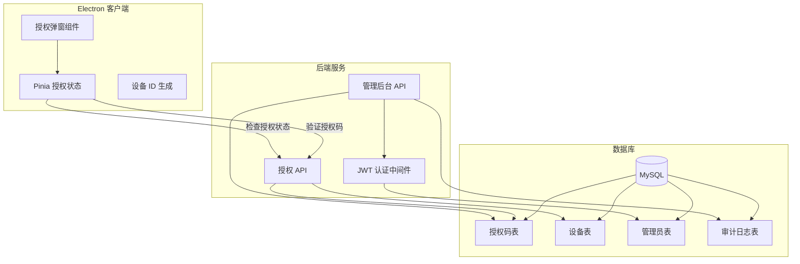
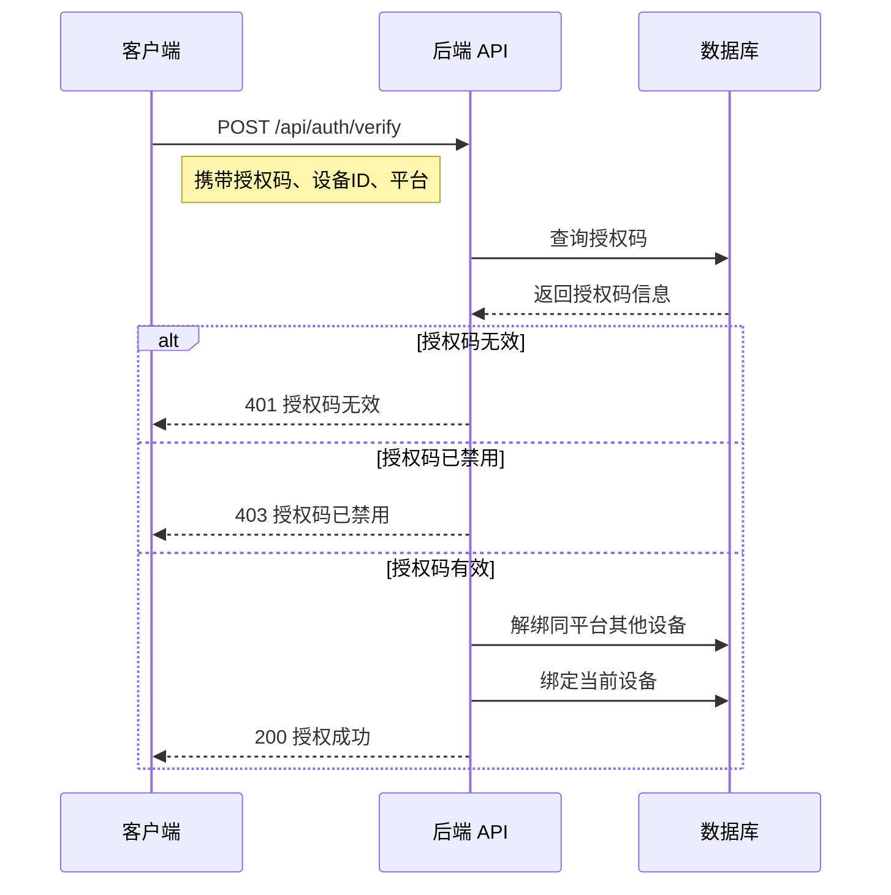
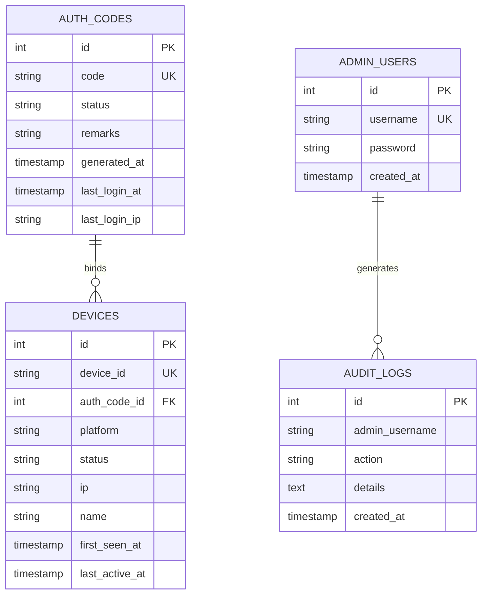

<div align="center">

<h2> SPlayer </h2>
<p> 一个简约的音乐播放器 </p>

[API Docs](https://splayer.imsyy.top/api.html) | [交流群](https://qm.qq.com/cgi-bin/qm/qr?k=2-cVSf1bE0AvAehCib00qFEFdUvPaJ_k&jump_from=webapi&authKey=1NEhib9+GsmsXVo2rCc0IbRaVHeeRXJJ0gbsyKDcIwDdAzYySOubkFCvkV32+7Cw) | [开发版](https://github.com/imsyy/SPlayer/actions) | [发行版](https://splayer.imsyy.top/download.html)

<br />


[](https://github.com/imsyy/SPlayer/actions/workflows/release.yml)


</div>


## 说明


> [!IMPORTANT]
>
> ### 严肃警告
>
> - 请务必遵守 [GNU Affero General Public License (AGPL-3.0)](https://www.gnu.org/licenses/agpl-3.0.html) 许可协议
> - 在您的修改、演绎、分发或派生项目中，必须同样采用 **AGPL-3.0** 许可协议，**并在适当的位置包含本项目的许可和版权信息**
> - 若您用于售卖或其他盈利用途，**必须提供本项目的源代码及原项目链接**。另外由于本项目涉及第三方，**售卖后可能遭受法律或诉讼风险**。如若发现违反许可协议，作者保留追究法律责任的权利
> - 禁止在二开项目中修改程序原版权信息（ 您可以添加二开作者信息 ）
> - 感谢您的尊重与理解

- 本项目采用 [Vue 3](https://cn.vuejs.org/) + [TypeScript](https://www.typescriptlang.org/) + [Naïve UI](https://www.naiveui.com/) + [Electron](https://www.electronjs.org/zh/docs/latest/) 开发
- 支持网页端与客户端，由于设备有限，目前仅保证 Windows 系统的适配，其他平台如遇问题可以提 Issue 或自行解决后选择提 PR
<!-- - 仅对移动端做了基础适配，**不保证功能全部可用** -->

<!--  > 请注意，本程序不打算开发移动端，也不会对移动端进行完美适配，仅保证基础可用性 -->

- 欢迎各位大佬 `Star` 😍

## 💬 交流群

<a href="https://qm.qq.com/cgi-bin/qm/qr?k=2-cVSf1bE0AvAehCib00qFEFdUvPaJ_k&jump_from=webapi&authKey=1NEhib9+GsmsXVo2rCc0IbRaVHeeRXJJ0gbsyKDcIwDdAzYySOubkFCvkV32+7Cw" target="_blank">
  
</a>

## 👀 Demo

- 在线演示：[SPlayer](https://music.imsyy.top/)

  > 如打不开，说明已经失效请自行前往 [获取](#️-获取)

## 🎉 功能

- ✨ 支持扫码登录
- 📱 支持手机号登录
- ~~📅 自动进行每日签到及云贝签到~~
- 💻 支持桌面歌词
- 💻 支持切换为本地播放器，此模式将不会连接网络
- 🎨 封面主题色自适应，支持全站着色
- 🌚 Light / Dark / Auto 模式自动切换
- 📁 本地歌曲管理及分类（建议先使用 [音乐标签](https://www.cnblogs.com/vinlxc/p/11347744.html) 进行匹配后再使用）
- 📁 本地音乐标签编辑及封面修改
- 🎵 **支持播放部分无版权歌曲（可能会与原曲不匹配，客户端独占功能）**
- ⬇️ 下载歌曲 / 批量下载（ 最高支持 Hi-Res，需具有相应会员账号 ）
- ➕ 新建歌单及歌单编辑
- ❤️ 收藏 / 取消收藏歌单或歌手
- 🎶 每日推荐歌曲
- 📻 私人 FM
- ☁️ 云盘音乐上传
- 📂 云盘内歌曲播放
- 🔄 云盘内歌曲纠正
- 🗑️ 云盘歌曲删除
- 🌐 支持 Subsonic / Navidrome 流媒体服务（多服务器支持、自动连接）
- 📝 支持逐字歌词
- 🔄 歌词滚动以及歌词翻译
- 📹 MV 与视频播放
- 🎶 音乐频谱显示
- ⏭️ 音乐渐入渐出
- 🔄 支持 PWA
- 💬 支持评论区
- 🎵 支持 Last.fm Scrobble（播放记录上报）
- 📱 移动端基础适配

## 🖼️ 界面展示

> 开发中，仅供参考

<details>
<summary> 主页面 </summary>


</details>

<details>
<summary> 播放页面 </summary>


</details>

<details>
<summary> 发现页面 </summary>


</details>

<details>
<summary> 歌单页面 </summary>


</details>

<details>
<summary> 评论页面 </summary>


</details>

<details>
<summary> 本地音乐 </summary>


</details>

## 🔐 授权系统

本项目包含一套完整的应用授权系统，用于控制客户端的访问权限。该系统仅对 Electron 桌面客户端生效，Web 端无需授权。

### 系统架构



### 前端实现

#### 授权状态管理

授权状态通过 Pinia Store 进行管理，主要文件为 [`src/stores/auth.ts`](src/stores/auth.ts)：

```typescript
// 核心状态
interface AuthState {
    isAuthorized: boolean;      // 是否已授权
    authCode: string | null;    // 当前授权码
    deviceId: string;           // 设备唯一标识
    isChecking: boolean;        // 是否正在验证
    errorMessage: string | null; // 错误信息
}
```

**核心功能：**
- **设备 ID 生成**：首次启动时生成唯一设备 ID 并存储在 localStorage
- **平台检测**：自动识别 Windows/macOS 平台
- **授权验证**：调用后端 API 验证授权码有效性
- **状态持久化**：授权状态通过 `pinia-plugin-persistedstate` 持久化存储

#### 授权弹窗组件

授权弹窗组件位于 [`src/components/Modal/GlobalAuthModal.vue`](src/components/Modal/GlobalAuthModal.vue)：

- 仅在 Electron 环境下显示
- 未授权时阻止应用其他功能使用
- 支持回车键快捷验证
- 显示详细的错误提示信息

#### 应用入口集成

在 [`src/App.vue`](src/App.vue) 中进行授权检查初始化：

```typescript
// 仅 Electron 端需要授权验证
if (isElectron) {
  const authStore = useAuthStore();
  onMounted(() => {
    authStore.checkAuth();
  });
}
```

### 后端服务实现

#### API 端点

| 端点 | 方法 | 说明 |
|------|------|------|
| `/api/auth/verify` | POST | 验证授权码并绑定设备 |
| `/api/auth/check` | GET | 检查设备授权状态 |
| `/api/admin/login` | POST | 管理员登录 |
| `/api/admin/dashboard` | GET | 获取仪表盘数据 |
| `/api/admin/codes` | GET/POST | 授权码管理 |

#### 授权验证流程



#### 平台独立绑定机制

系统采用**按平台独立绑定**策略，即：
- 同一授权码可在 Windows 和 macOS 各绑定一台设备
- 同一平台的新设备登录会自动踢掉该平台的旧设备
- 实现代码位于 [`server/routes/auth.ts`](server/routes/auth.ts)

### 数据库设计

数据库初始化脚本位于 [`scripts/init_database.sql`](scripts/init_database.sql)。

#### 核心表结构

```sql
-- 授权码表
CREATE TABLE auth_codes (
  id INT AUTO_INCREMENT PRIMARY KEY,
  code VARCHAR(50) UNIQUE NOT NULL,        -- 授权码
  status ENUM('unused', 'active', 'disabled'), -- 状态
  remarks VARCHAR(255),                     -- 备注
  generated_at TIMESTAMP DEFAULT CURRENT_TIMESTAMP,
  last_login_at TIMESTAMP NULL,
  last_login_ip VARCHAR(50) NULL
);

-- 设备表
CREATE TABLE devices (
  id INT AUTO_INCREMENT PRIMARY KEY,
  device_id VARCHAR(100) NOT NULL,          -- 设备唯一标识
  auth_code_id INT NULL,                    -- 绑定的授权码ID
  platform VARCHAR(20) DEFAULT 'android',   -- 平台：windows/macos/android/ios
  status ENUM('active', 'banned'),          -- 设备状态
  ip VARCHAR(50),                           -- 最后登录IP
  name VARCHAR(100),                        -- 设备名称
  first_seen_at TIMESTAMP DEFAULT CURRENT_TIMESTAMP,
  last_active_at TIMESTAMP DEFAULT CURRENT_TIMESTAMP,
  FOREIGN KEY (auth_code_id) REFERENCES auth_codes(id)
);

-- 管理员表
CREATE TABLE admin_users (
  id INT AUTO_INCREMENT PRIMARY KEY,
  username VARCHAR(50) UNIQUE NOT NULL,
  password VARCHAR(255) NOT NULL,           -- bcrypt 加密存储
  created_at TIMESTAMP DEFAULT CURRENT_TIMESTAMP
);

-- 审计日志表
CREATE TABLE audit_logs (
  id INT AUTO_INCREMENT PRIMARY KEY,
  admin_username VARCHAR(50),
  action VARCHAR(50),                       -- 操作类型
  details TEXT,
  created_at TIMESTAMP DEFAULT CURRENT_TIMESTAMP
);
```

#### ER 图



### 管理后台

项目内置 Web 管理后台，提供授权码管理和数据统计功能：

- **访问地址**：`/admin`
- **功能模块**：
  - 仪表盘：总授权码数、活跃授权码数、昨日在线人数统计
  - 授权码管理：生成、查询、编辑、禁用授权码
  - 设备管理：查看设备列表、封禁设备
  - 操作日志：记录管理员操作历史

## 🔧 构建与运行

### 环境要求

- Node.js >= 20
- pnpm >= 8（推荐使用 pnpm）
- Rust 工具链（可选，用于原生模块开发）

### 安装依赖

```bash
# 安装 pnpm（如未安装）
npm install pnpm -g

# 安装项目依赖
pnpm install
```

### 开发命令

| 命令 | 说明 |
|------|------|
| `pnpm dev` | 启动 Electron 开发模式（包含热重载） |
| `pnpm web:dev` | 启动 Web 开发服务器（仅渲染进程） |
| `pnpm docs:dev` | 启动文档开发服务器 |

### 构建命令

| 命令 | 说明 |
|------|------|
| `pnpm build` | 构建所有平台客户端（当前架构） |
| `pnpm build:win` | 构建 Windows 客户端 |
| `pnpm build:linux` | 构建 Linux 客户端 |
| `pnpm build:mac` | 构建 macOS 客户端 |
| `pnpm build:web` | 构建 Web 前端（无 Electron） |
| `pnpm build:native` | 单独构建 Rust 原生模块 |

> **提示**：如需构建多架构版本，可在命令后追加参数，例如：`pnpm build:win -- --x64 --arm64`

### 服务器命令

| 命令 | 说明 |
|------|------|
| `pnpm server:dev` | 开发模式启动后端服务器 |
| `pnpm build:server` | 编译后端 TypeScript |
| `pnpm server:start` | 启动编译后的后端服务 |
| `pnpm server` | 构建并启动后端服务（生产模式） |
| `pnpm server:verify` | 验证服务器配置 |

服务器默认运行在 `http://localhost:25884`，可通过环境变量 `VITE_SERVER_PORT` 修改端口。

### 代码质量命令

| 命令 | 说明 |
|------|------|
| `pnpm lint` | 运行 ESLint 检查并自动修复 |
| `pnpm format` | 使用 Prettier 格式化代码 |
| `pnpm typecheck` | TypeScript 类型检查 |

### 环境变量配置

复制 `.env.example` 为 `.env` 并按需修改：

```bash
# 必填：网易云音乐 API 地址
VITE_API_URL=https://your-api.example.com

# 可选：服务器配置
VITE_SERVER_PORT=25884

# 可选：数据库配置（服务器模式）
DB_HOST=localhost
DB_USER=root
DB_PASSWORD=your_password
DB_NAME=music
DB_PORT=3306

# 可选：JWT 密钥
JWT_SECRET=your_secret_key
```

### 常见问题

**Q: `pnpm install` 失败？**
> 检查网络连接，可使用国内镜像源：`pnpm config set registry https://registry.npmmirror.com`

**Q: 原生模块编译失败？**
> 确保已安装 Rust 工具链：`curl --proto '=https' --tlsv1.2 -sSf https://sh.rustup.rs | sh`

**Q: Electron 启动白屏？**
> 检查控制台错误，可能是 API 地址配置错误或服务未启动

## 📦️ 获取

### 二进制安装方案

#### 稳定版

通常情况下，可以在 [Releases](https://github.com/imsyy/SPlayer/releases) 中获取稳定版

也可前往 [SPlayer 官网](https://splayer.imsyy.top/) 获取稳定版

#### 开发版

可以通过 GitHub Actions 工作流获取最新的开发版

[Dev Workflow](https://github.com/imsyy/SPlayer/actions/workflows/dev.yml)

### 自行部署方案

#### ⚙️ Docker 部署

> 安装及配置 `Docker` 将不在此处说明，请自行解决

##### 本地构建

> 请尽量拉取最新分支后使用本地构建方式，在线部署的仓库可能更新不及时

```bash
# 构建
docker build -t splayer .

# 运行
docker run -d --name SPlayer -p 25884:25884 splayer
# 或使用 Docker Compose
docker-compose up -d
```

##### 在线部署

```bash
# 从 Docker Hub 拉取
docker pull imsyy/splayer:latest
# 从 GitHub ghcr 拉取
docker pull ghcr.io/imsyy/splayer:latest

# 运行
docker run -d --name SPlayer -p 25884:25884 imsyy/splayer:latest
```

以上步骤成功后，将会在本地 [localhost:25884](http://localhost:25884/) 启动，如需更换端口，请自行修改命令行中的第一个端口号

#### ⚙️ Vercel 部署

> 其他部署平台大致相同，在此不做说明

1. 本程序依赖 [NeteaseCloudMusicApi](https://github.com/neteasecloudmusicapienhanced/api-enhanced) 运行，请确保您已成功部署该项目或兼容的项目，并成功取得在线访问地址
2. 点击本仓库右上角的 `Fork`，复制本仓库到你的 `GitHub` 账号
3. 复制 `/.env.example` 文件并重命名为 `/.env`
4. 将 `.env` 文件中的 `VITE_API_URL` 改为第一步得到的 API 地址

   ```js
   VITE_API_URL = "https://example.com";
   ```

5. 将 `Build and Output Settings` 中的 `Output Directory` 改为 `out/renderer`

   

6. 点击 `Deploy`，即可成功部署

#### ⚙️ 服务器部署

1. 重复 `⚙️ Vercel 部署` 中的 1 - 4 步骤
2. 克隆仓库

   ```bash
   git clone https://github.com/imsyy/SPlayer.git
   ```

3. 安装依赖

   ```bash
   pnpm install
   # 或
   yarn install
   # 或
   npm install
   ```

4. 编译打包

   ```bash
   pnpm build
   # 或
   yarn build
   # 或
   npm build
   ```

5. 将站点运行目录设置为 `out/renderer` 目录

#### ⚙️ 本地部署

1. 本地部署需要用到 `Node.js`。可前往 [Node.js 官网](https://nodejs.org/zh-cn/) 下载安装包，请下载最新稳定版
2. 安装 pnpm

   ```bash
   npm install pnpm -g
   ```

3. 克隆仓库并拉取至本地，此处不再赘述
4. 使用 `pnpm install` 安装项目依赖（若安装过程中遇到网络错误，请使用国内镜像源替代，此处不再赘述）
5. 复制 `/.env.example` 文件并重命名为 `/.env` 并修改配置
6. 打包客户端，请依据你的系统类型来选择，打包成功后，会输出安装包或可执行文件在 `/dist` 目录中，可自行安装

   > 默认情况下，构建命令仅会构建当前系统架构的版本。如需构建特定架构（如 x64 + arm64），请在命令后追加参数，例如：`pnpm build:win -- --x64 --arm64`

   | 命令               | 系统类型 |
   | ------------------ | -------- |
   | `pnpm build:win`   | Windows  |
   | `pnpm build:linux` | Linux    |
   | `pnpm build:mac`   | macOS    |

## 😘 鸣谢

特此感谢为本项目提供支持与灵感的项目：

- [NeteaseCloudMusicApi](https://github.com/neteasecloudmusicapienhanced/api-enhanced)
- [YesPlayMusic](https://github.com/qier222/YesPlayMusic)
- [UnblockNeteaseMusic](https://github.com/UnblockNeteaseMusic/server)
- [applemusic-like-lyrics](https://github.com/Steve-xmh/applemusic-like-lyrics)
- [Vue-mmPlayer](https://github.com/maomao1996/Vue-mmPlayer)
- [refined-now-playing-netease](https://github.com/solstice23/refined-now-playing-netease)
- [material-color-utilities](https://github.com/material-foundation/material-color-utilities)

## 🗺️ 贡献者联盟

欢迎加入我们 🥰! 一起为 SPlayer 贡献一份力量。
感谢以下所有贡献者 💖

<a href="https://github.com/imsyy/SPlayer/graphs/contributors" target="_blank" rel="noopener">
  
</a>

## 📢 免责声明

本项目部分功能使用了网易云音乐的第三方 API 服务，**仅供个人学习研究使用，禁止用于商业及非法用途**

同时，本项目开发者承诺 **严格遵守相关法律法规和网易云音乐 API 使用协议，不会利用本项目进行任何违法活动。** 如因使用本项目而引起的任何纠纷或责任，均由使用者自行承担。**本项目开发者不承担任何因使用本项目而导致的任何直接或间接责任，并保留追究使用者违法行为的权利**

请使用者在使用本项目时遵守相关法律法规，**不要将本项目用于任何商业及非法用途。如有违反，一切后果由使用者自负。** 同时，使用者应该自行承担因使用本项目而带来的风险和责任。本项目开发者不对本项目所提供的服务和内容做出任何保证

感谢您的理解

## 📜 开源许可

- **本项目仅供个人学习研究使用，禁止用于商业及非法用途**
- 本项目基于 [GNU Affero General Public License (AGPL-3.0)](https://www.gnu.org/licenses/agpl-3.0.html) 许可进行开源
  1. **修改和分发：** 任何对本项目的修改和分发都必须基于 AGPL-3.0 进行，源代码必须一并提供
  2. **派生作品：** 任何派生作品必须同样采用 AGPL-3.0，并在适当的地方注明原始项目的许可证
  3. **注明原作者：** 在任何修改、派生作品或其他分发中，必须在适当的位置明确注明原作者及其贡献
  4. **免责声明：** 根据 AGPL-3.0，本项目不提供任何明示或暗示的担保。请详细阅读 [GNU Affero General Public License (AGPL-3.0)](https://www.gnu.org/licenses/agpl-3.0.html) 以了解完整的免责声明内容
  5. **社区参与：** 欢迎社区的参与和贡献，我们鼓励开发者一同改进和维护本项目
  6. **许可证链接：** 请阅读 [GNU Affero General Public License (AGPL-3.0)](https://www.gnu.org/licenses/agpl-3.0.html) 了解更多详情

## ⭐ Star History

[](https://star-history.com/#imsyy/SPlayer&Date)
